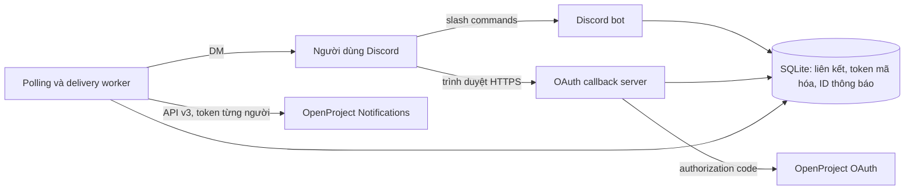

# Kiến trúc và kế hoạch triển khai

Microservice chạy độc lập, không sửa source, plugin hoặc database OpenProject.
MVP dành cho một instance OpenProject tại `https://openproject.lazy247.space` và một bot Discord.

## Quyết định kiến trúc

- Python 3.12, discord.py cho Gateway/slash commands và giới hạn tốc độ Discord;
  FastAPI/Uvicorn cho callback; httpx cho OpenProject; SQLite cho một tiến trình MVP.
- Không yêu cầu privileged intents, đọc message content, quyền Administrator trên Discord,
  tài khoản OpenProject quản trị dùng chung, hoặc truy cập DB OpenProject.
- OAuth confidential application, scope `api_v3`, Authorization Code theo tài liệu chính thức.
  Scope này không phải scope chỉ đọc; code MVP chỉ đọc dữ liệu API v3.
- Polling notification in-app của từng người. Webhook sự kiện work package không phải nguồn
  thay thế tương đương: MVP không tự tính ai là người nhận từ assignee/watchers/mentions.
- Một liên kết cho mỗi Discord ID và mỗi OpenProject user ID, ràng buộc UNIQUE trong DB.
- Hàng đợi bền vững gộp bảng dấu vết ID và trạng thái `baseline/pending/sent/unavailable`.
  Chỉ lưu ID thông báo; không lưu nội dung work package/comment.

## Luồng liên kết

1. `/op link` lấy Discord ID từ interaction đã được Discord xác thực.
2. Bot trả URL riêng bằng ephemeral response, ticket ngẫu nhiên 256 bit, TTL 10 phút.
3. `/link` tiêu thụ ticket và chuyển đến OpenProject. OAuth state dùng một lần, gắn cookie
   `__Host-opbridge`, HttpOnly, Secure, SameSite=Lax, không dựa vào user ID trong query.
4. Callback kiểm tra state và cookie, đổi code tại `/oauth/token`, đọc `/api/v3/users/me`.
5. Trình duyệt hiển thị tên/ID OpenProject cùng mã xác nhận một lần. Người dùng chạy
   `/op confirm code:...` bằng chính tài khoản Discord ban đầu. Tới đây mới tạo liên kết.
6. Trước khi kích hoạt, lấy đầy đủ thông báo hiện tại làm baseline để không gửi lịch sử cũ.
   Lỗi/thiếu trang thì không kích hoạt. Mã, ticket và state lưu dạng SHA-256; token được mã hóa.

## Polling, gửi tin và lỗi

- Chu kỳ mặc định 60 giây mỗi người, scheduler thức mỗi 5 giây; độ trễ tăng theo số người,
  số trang, backlog và giới hạn tốc độ. Tối đa 20 DM/người/chu kỳ mặc định.
- Giới hạn một lượt xử lý tài khoản là 120 giây để tài khoản chậm không giữ worker vô hạn;
  khi hết thời gian, job chưa xác nhận thành công vẫn giữ trong queue để thử lại.
- Lấy tất cả notification, sort ID tăng dần, theo `nextByOffset`; pageSize đề nghị 100,
  tôn trọng link phân trang do server trả. Không giả định ID liên tục hoặc chỉ có một trang.
- Lưu ID mới bằng khóa `(discord_id, notification_id)` trước khi gửi. Thông báo đã đọc
  trên OpenProject vẫn có thể được chuyển nếu ID mới được quan sát sau baseline.
- Trước từng DM, GET notification bằng token chính người nhận; 404 chuyển `unavailable`.
  Token hết hạn được refresh và ghi token mới xuống DB trước request tiếp theo.
- Không POST `read_ian`, không thay đổi dữ liệu/ngày đọc trên OpenProject.
- Timeout/5xx có backoff; 429 tôn trọng Retry-After và tạm dừng request OpenProject toàn service.
  400/401/403/404 ở cấp tài khoản đặt `needs_attention`, hiện trong `/op status`.
  403 khi gửi DM giữ queue và backoff tối đa một giờ; không gửi vào kênh công khai thay thế.
- Đọc trạng thái đầy đủ và chạy lại scan giúp phục hồi khi phân trang thay đổi giữa request.
  API offset không cung cấp snapshot nguyên tử: thông báo bị xóa trước lần quan sát có thể mất.
- Cùng ID được cập nhật/gộp trong OpenProject không tạo DM thứ hai. Đây là bridge cho ID
  notification mới, không phải nhật ký mọi thay đổi work package.
- Ngữ nghĩa gửi **at-least-once cho job đã quan sát và còn khả dụng**, không cam kết exactly-once:
  nếu Discord nhận DM rồi tiến trình chết trước khi ghi `sent`, có thể gửi lặp khi khởi động lại.
- `/op unlink` chờ thao tác đang chạy cùng người dùng hoàn tất, xóa token/queue/phiên chờ.
  DM đã gửi không bị thu hồi. Hủy quyền OAuth phía OpenProject thực hiện trong UI của OpenProject.

## An toàn và vận hành

- Fernet mã hóa access/refresh token và pending credentials. Khóa ở secret môi trường,
  không cùng file DB. Tên/ID và metadata queue không mã hóa. Backup cần kiểm soát quyền truy cập.
- TLS cho cả hai origin. Không follow redirect khi gọi API; kiểm tra origin và path của
  pagination link để không chuyển Authorization sang host khác. Không fetch URL tùy ý từ input.
- Không log request URL, body, OAuth code/token/state. Reverse proxy cũng không được log
  query string trên `/link` và `/oauth/callback`; cấu hình mẫu tắt access log.
- Escape HTML/Discord markdown, vô hiệu hóa mentions, giới hạn độ dài embed.
- File lock chặn tiến trình thứ hai dùng cùng DB. Không scale replica hay dùng volume NFS.
  Các lock theo người dùng tuần tự hóa refresh, gửi DM và unlink.
- `/healthz`: tiến trình HTTP; `/readyz`: Discord sẵn sàng và worker đang hoạt động.
  Readiness không đảm bảo mọi tài khoản đều có quyền API; xem `/op status` và log.
- Ledger ID hiện giữ đến khi unlink để không gửi lặp dữ liệu cũ; theo dõi dung lượng DB.
  Pending OAuth hết hạn được dọn mỗi vòng worker. Xóa logic không đảm bảo xóa bản sao backup/WAL.

## Các giai đoạn

| Giai đoạn | Kết quả | Điều kiện hoàn tất |
|---|---|---|
| 1. Khảo sát | Danh mục endpoint, quyền, giới hạn phiên bản | Đối chiếu docs và chạy probe trên instance |
| 2. MVP | OAuth + confirm, status/unlink, polling, DM, SQLite | Test tự động pass; build được service |
| 3. Staging | Hai tài khoản OpenProject/Discord | Đúng người nhận, refresh token, restart, chặn DM, thu hồi quyền |
| 4. Vận hành | HTTPS, secret, backup, health monitoring | Chạy ổn định trên VPS, kiểm tra khôi phục backup |
| 5. Mở rộng khi cần | PostgreSQL, nhiều worker, metrics, tùy chọn lọc/digest | Đo tải rồi bổ sung queue lease và migration |

MVP không cần Redis hay message broker riêng. Khi cần nhiều replica, phải thay SQLite/file lock
bằng kho dùng chung và cơ chế nhận job độc quyền trước khi tăng số worker.
