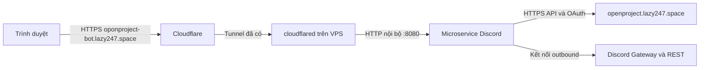

# Cùng VPS với OpenProject, sử dụng Cloudflare Tunnel

## Topology đã xác minh ngày 2026-10-15

OpenProject và bot ở `192.168.1.12`; Caddy ở `192.168.1.51`; AdGuard DNS ở
`192.168.1.50`. OpenProject đang dùng cổng host `8080`, nên bot được cấu hình
bind `192.168.1.12:8081`. Máy Caddy không chạy `cloudflared` và Caddyfile hiện
không có route hostname công khai của OpenProject. Trong Cloudflare Zero Trust,
đã chọn **tunnel hiện đang phục vụ OpenProject** và thêm published application route:

| Trường | Giá trị |
|---|---|
| Subdomain | `op-discord` |
| Domain | `lazy247.space` |
| Service type | `HTTP` |
| Service URL | `http://192.168.1.12:8081` |

Connector của tunnel truy cập được IP `192.168.1.12`: HTTP server tạm trên cổng 8081
trả 200 qua HTTPS công khai, sau đó đã dừng. Các hướng dẫn localhost/Docker-network
bên dưới chỉ áp dụng khi Tunnel thực sự chạy cùng host với bot.

Đây là phương án triển khai theo môi trường bạn cung cấp. Dùng tunnel đang chạy, thêm route
cho microservice. Không sửa source/config ứng dụng OpenProject và không thay route của nó.

Hostname đã chọn: **`oponproject-bot.lazy247.space`**; route đã được kiểm tra;
bạn có thể chọn tên khác. Dùng cùng một giá trị ở mọi bước:

```dotenv
OPENPROJECT_URL=https://openproject.lazy247.space
PUBLIC_URL=https://oponproject-bot.lazy247.space
```

Redirect URI của OAuth application trên OpenProject phải là:
`https://oponproject-bot.lazy247.space/oauth/callback`.



## Nếu cloudflared chạy trực tiếp trên VPS hoặc dùng host network

Giữ `compose.yaml`. Cổng bot chỉ bind `127.0.0.1:8080` của VPS.

Trong Cloudflare, mở tunnel hiện tại và thêm **Published application route**:

| Trường | Giá trị |
|---|---|
| Public hostname | `oponproject-bot.lazy247.space` |
| Service type | HTTP |
| Service URL | `127.0.0.1:8080` |
| Path | Để trống |

Không cần Caddy/Nginx hoặc mở cổng inbound cho bot; Cloudflare nhận HTTPS bên ngoài,
`cloudflared` chuyển HTTP nội bộ tới service. Không đặt service URL bằng hostname công khai
của bot vì sẽ tạo vòng lặp về tunnel.

## Nếu cloudflared chạy trong Docker bridge network

`127.0.0.1` trong container cloudflared chỉ là chính container đó. Dùng network chung:

1. Xác định tên Docker network mà container cloudflared đang tham gia. Ví dụ kiểm tra:
   `docker inspect <ten-container-cloudflared> --format '{{json .NetworkSettings.Networks}}'`.
2. Thêm vào `.env`: `CLOUDFLARE_TUNNEL_NETWORK=<ten-network-hien-co>`.
3. Chạy cùng override cho mọi thao tác Compose:

```bash
docker compose -f compose.yaml -f compose.tunnel.yaml up -d --build
docker compose -f compose.yaml -f compose.tunnel.yaml ps
```

4. Trong route Cloudflare, chọn HTTP và Service URL **`op-discord-bridge:8080`**.
   Alias này được khai báo trong override; không dùng tên container ngẫu nhiên.

Override không thay đổi container/tunnel OpenProject và không tạo tunnel mới.
Network chỉ dùng chung để cloudflared truy cập bot; bot vẫn gọi API OpenProject qua origin
HTTPS đã cấu hình. Cổng localhost trong compose mặc định vẫn dùng được để kiểm tra trên VPS.

## Nếu tunnel quản lý bằng file config.yml

Thêm rule sau vào danh sách `ingress` hiện có, **trước rule catch-all cuối cùng**;
giữ các rule OpenProject và thông tin tunnel/credentials đang dùng:

```yaml
- hostname: oponproject-bot.lazy247.space
  service: http://127.0.0.1:8080
```

Với cloudflared trong Docker, đổi service thành `http://op-discord-bridge:8080` và dùng network
chung như trên. Tạo DNS route cho hostname vào cùng tunnel bằng quy trình quản lý tunnel
hiện tại. Đoạn YAML trên là một rule để ghép, **không phải file config thay thế hoàn chỉnh**.

## Kiểm tra

```bash
curl -fsS http://127.0.0.1:8080/healthz
curl -fsS https://oponproject-bot.lazy247.space/healthz
curl -fsS https://oponproject-bot.lazy247.space/readyz
```

`readyz` chỉ đạt khi Discord bot đã đăng nhập và worker chạy. Không cache `/link` hoặc
`/oauth/callback`; application trả `Cache-Control: no-store`. Không bật rule cache cưỡng ép
cho hostname bot. Tránh ghi query OAuth vào access log/Logpush theo cấu hình lưu log của bạn.

Nếu Cloudflare Access đang áp dụng trên toàn domain, cấu hình quyền truy cập hostname bot
để người dùng có thể tới `/link` và `/oauth/callback`. App vẫn yêu cầu ticket/state và xác nhận
bằng Discord. Không vô hiệu hóa bảo vệ toàn bộ domain OpenProject để xử lý một route bot.

Nếu probe OpenProject vẫn nhận 403, xem response/status và Cloudflare Security Events để
xác định request bị chặn ở đâu. API và `/oauth/token` là request server-to-server, không thể
giải browser challenge. Chỉ điều chỉnh chính sách cho traffic tích hợp cần thiết sau khi xác
định nguyên nhân. MVP chưa hỗ trợ Cloudflare Access service-token headers; nếu OpenProject
được bảo vệ bằng Access, cần cấu hình phù hợp hoặc bổ sung hỗ trợ này trước khi go-live.

Tài liệu chính thức: [Published application routes](https://developers.cloudflare.com/tunnel/get-started/),
[HTTP service sau HTTPS công khai](https://developers.cloudflare.com/cloudflare-one/networks/connectors/cloudflare-tunnel/routing-to-tunnel/protocols/),
[Tránh vòng lặp origin](https://developers.cloudflare.com/tunnel/troubleshooting/https-origins/).
